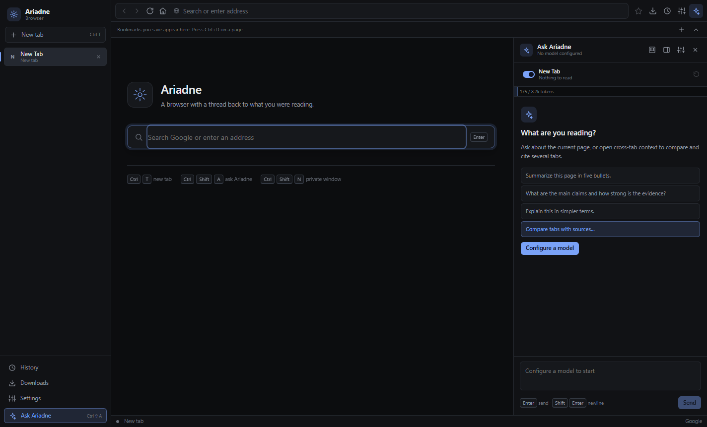
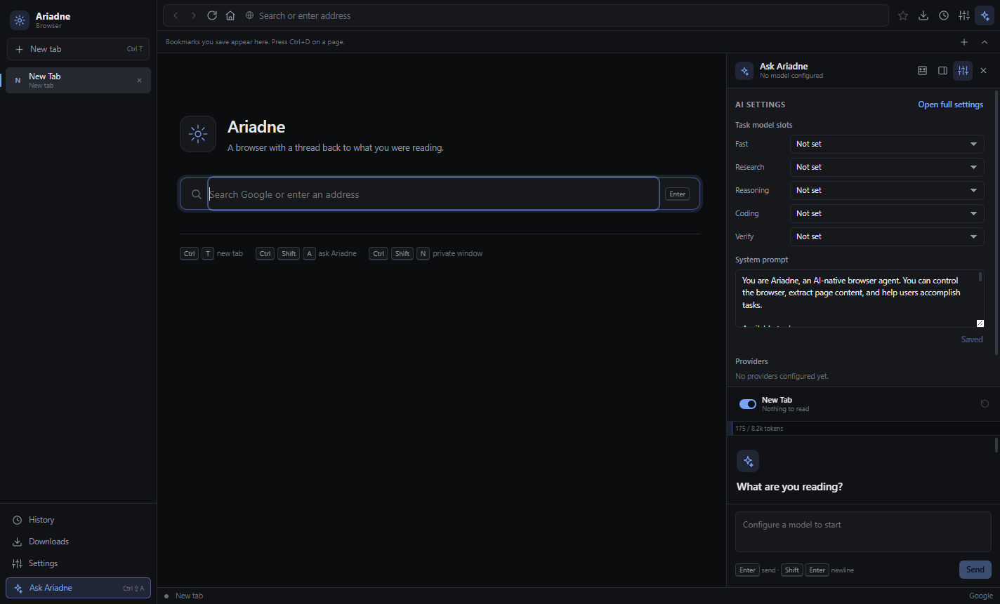
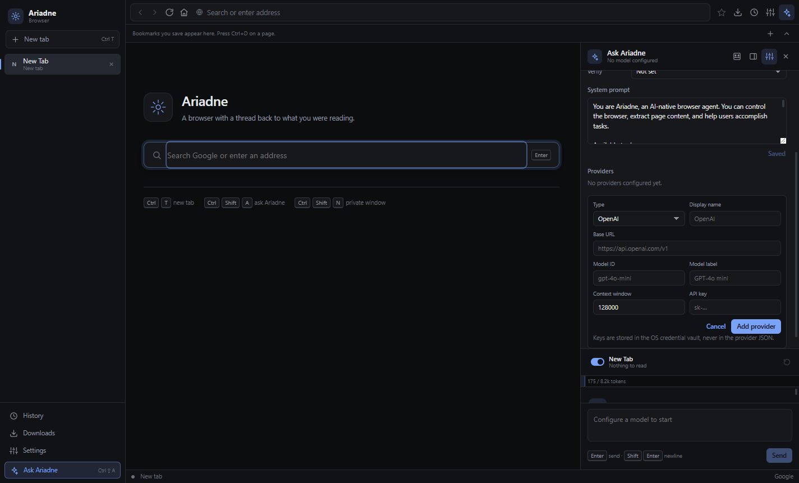
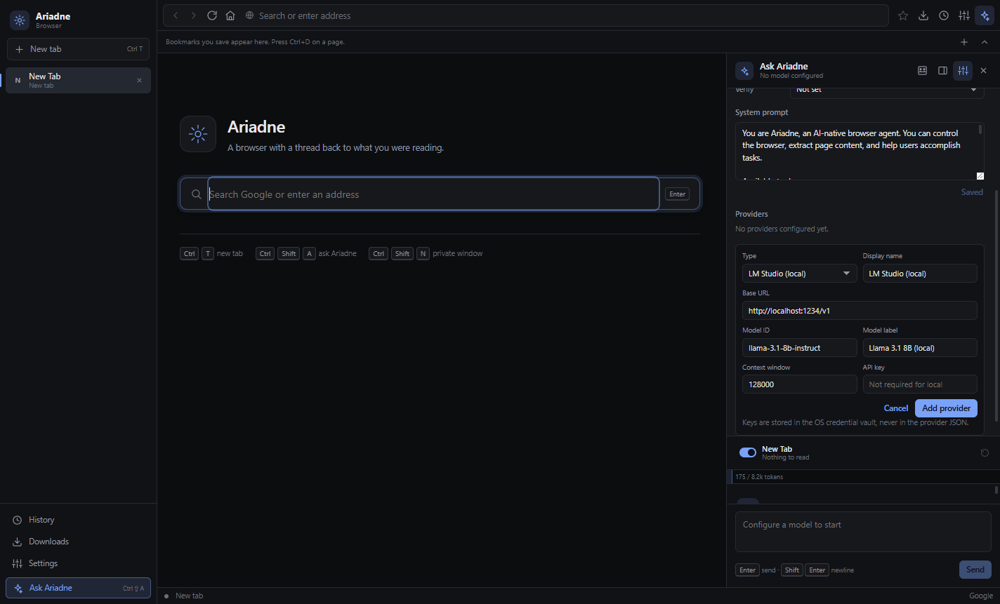
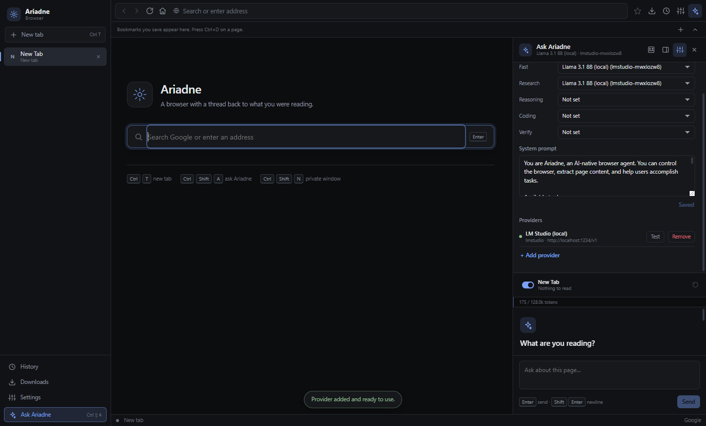
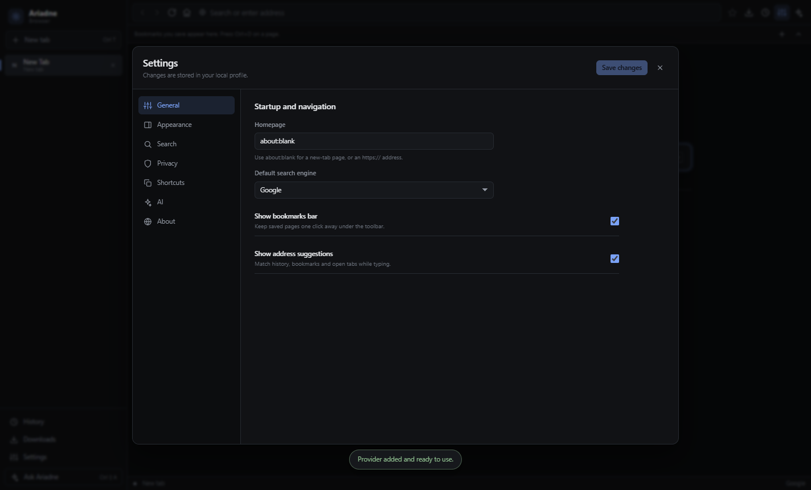
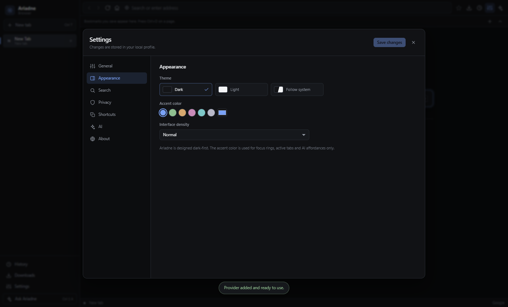
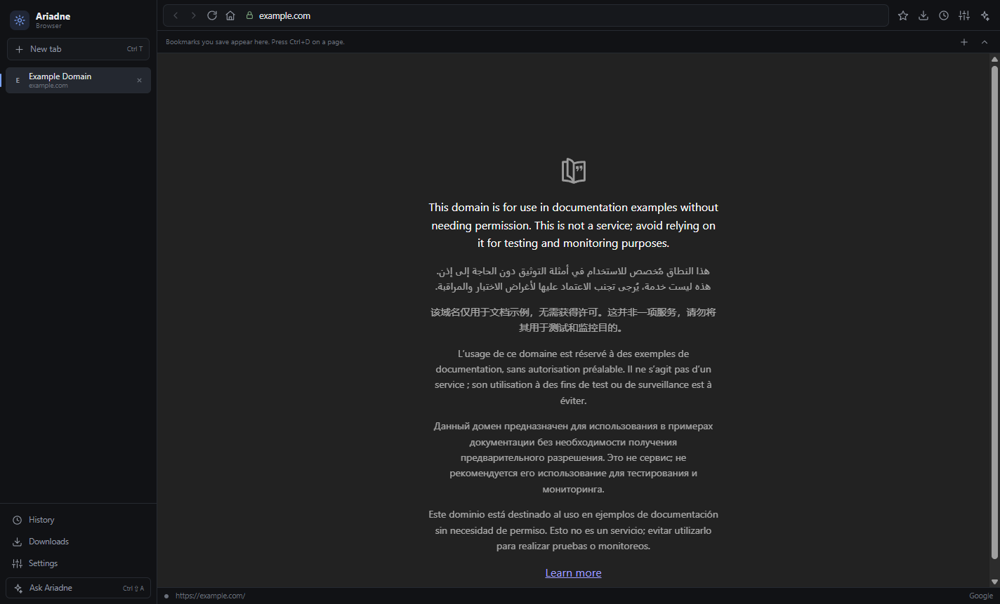

# Ariadne Browser

An AI-native desktop browser built with Electron, React, and TypeScript. Browser first, AI second.

## Current Status (v0.2.0)

**Working:**
- Multi-tab browsing (horizontal tabs with drag-reorder, pin, mute, duplicate, middle-click close, reopen closed)
- Address bar with URL entry + search detection, search suggestions from history/bookmarks/open tabs
- Navigation: back, forward, reload, stop, home, view source (Ctrl+U)
- Downloads panel with progress, pause/resume/cancel, open file/folder, retry, filter
- Bookmarks bar with nested folders, manager with add/edit/delete/move, HTML import/export
- History page with search, date groups, time filters, clear browsing data dialog
- Settings: 7 sections (General, Appearance, Search engines, Privacy, Shortcuts, AI, About)
- New Tab Page with search, top sites from history, recently closed tabs
- Find in page (Ctrl+F), per-tab zoom (Ctrl+/-, Ctrl+0), fullscreen (F11), print (Ctrl+P)
- Private window (separate session partition), 30+ global shortcuts
- Status bar with loading/zoom/security indicators
- Persistent sessions, SQLite history (1000 entries)
- AI provider system: 5 providers (OpenAI, Anthropic, 9Router, LM Studio local, Custom)
- **Multi-API key support per provider** — add multiple keys, automatic rotation on rate limit/auth errors
- **Auto-fallback with context preservation** — when a provider fails, automatically retries with key rotation, then falls back to next provider while preserving conversation context
- Secure credentials via OS keychain (keytar), never exposed to renderer
- Model slot routing: 5 task slots (fastBrowsing, research, reasoning, coding, verification)
- Streaming chat in sidebar with stop button
- Cross-tab intelligence: page extraction, BM25 retrieval, Q&A with citations
- 27 passing tests for context pipeline
- **AI Agent runtime**: 10 browser automation tools (navigate, search, click, type, scroll, find, highlight, extract, screenshot, wait), agent loop with tool approval UI
- **Security hardening**: CSP headers, navigation restrictions, IPC sender validation, permission prompts
- **Performance**: Tab discarding at memory budget (1.5GB default), lazy restore, memory stats in status bar
- **Packaging**: Windows NSIS installer with custom icon

**Planned:**
- True per-tab webviews (currently single webview with src swapping)
- Search results page (internal, aggregated from multiple engines with AI summary)

## Screenshots

| New Tab Page | AI Sidebar | AI Settings | Add Provider Form |
|:------------:|:----------:|:-----------:|:-----------------:|
|  |  |  |  |

| Provider Form Filled | Provider Added | Settings | Appearance Settings | Web Page Loaded |
|:--------------------:|:--------------:|:--------:|:-------------------:|:---------------:|
|  |  |  |  |  |

## Demo


[Watch full demo video (MP4)](docs/demo.mp4)

## Quick Start

```bash
# Install dependencies
npm install

# Build main + renderer
npm run build:electron
npm run build:renderer

# Run tests (27 context pipeline tests)
npm test

# Launch browser
npm start
```

### AI Setup

The browser works without AI configured. To enable:

1. Open Settings → AI or click the 🤖 button in the address bar
2. Add a provider:
   - **LM Studio** (local, no API key): Start LM Studio server, add provider with base URL `http://localhost:1234/v1`
   - **OpenAI**: Add provider, set API key(s) via secure prompt
   - **Anthropic**: Add provider, set API key(s)
   - **9Router**: Add provider, set API key(s)
   - **Custom**: Any OpenAI-compatible endpoint (Ollama, vLLM, TGI, LocalAI, etc.)
3. Assign models to task slots (fastBrowsing, research, reasoning, coding, verification)
4. Use the AI sidebar (Ctrl+Shift+A) to chat with current page or cross-tab context

## AI Providers

| Provider | Type | Base URL | API Key Required | Notes |
|----------|------|----------|------------------|-------|
| OpenAI | `openai` | `https://api.openai.com/v1` | Yes | GPT-4o, GPT-4o-mini, etc. |
| Anthropic | `anthropic` | `https://api.anthropic.com/v1` | Yes | Claude 3.5 Sonnet, Haiku, Opus |
| 9Router | `9router` | `https://api.9router.com/v1` | Yes | Multi-model router |
| LM Studio | `lmstudio` | `http://localhost:1234/v1` | No | Local models via LM Studio server |
| Custom | `custom` | Any OpenAI-compatible | Optional | Ollama, vLLM, TGI, LocalAI, etc. |

**Multi-API Key Support:**
- Each provider can store **multiple API keys** (e.g., multiple OpenAI keys, multiple Anthropic keys)
- Keys stored securely in OS keychain (Windows Credential Manager, macOS Keychain, Linux Secret Service)
- **Automatic key rotation** on rate limits (429), auth errors (401/403), quotas
- **Auto-fallback to next provider** with context preserved when all keys exhausted
- Configure in Settings → AI → Provider → "Add API Key" (repeat for multiple)

**Adding a provider:**
1. Settings → AI → "Add Provider"
2. Select type, enter name, base URL
3. Add one or more API keys via secure prompt
4. Save → provider appears in list, test with "Health Check"
5. Enable "Allow Fallback" for providers you want as backups
6. Set "Fallback Priority" (lower = higher priority)
7. Assign models to slots in the Model Slots section

## Smart Fallback System

When a request fails, Ariadne automatically:

1. **Key Rotation** — tries next API key on same provider (for rate limits, auth errors)
2. **Retry with Backoff** — exponential backoff (1s, 2s, 4s, max 10s) for transient errors
3. **Provider Fallback** — switches to next allowed fallback provider, preserving full conversation context
4. **Model Selection** — uses first available model on fallback provider

All happens transparently — the chat stream continues without user intervention.

## Search Engines

Built-in search engines (configurable in Settings → Search):
- **Google** (`g`) — `https://www.google.com/search?q=%s`
- **DuckDuckGo** (`d`) — `https://duckduckgo.com/?q=%s`
- **Bing** (`b`) — `https://www.bing.com/search?q=%s`
- **Brave Search** (`br`) — `https://search.brave.com/search?q=%s`
- **Startpage** (`sp`) — `https://www.startpage.com/sp/search?query=%s`
- **Wikipedia** (`w`) — `https://en.wikipedia.org/w/index.php?search=%s`

**Keyword search:** Type `g query` or `d query` in address bar to search with that engine.

## AI Agent

The AI Agent allows the AI to autonomously browse:

| Capability | Description |
|------------|-------------|
| **Navigate** | Go to any URL |
| **Search** | Query search engines, parse results, click links |
| **Click** | Click links, buttons, elements by selector/text |
| **Type** | Fill forms, search boxes, inputs |
| **Scroll** | Scroll pages, find elements |
| **Find** | Search text on page, highlight matches |
| **Highlight** | Mark text, images, elements visually (colored overlays) |
| **Extract** | Read page content, tables, structured data |
| **Screenshot** | Capture viewport or element |
| **Wait** | Wait for navigation, elements, conditions |

Tools exposed via function calling to the AI model. The agent can:
- "Search for X and open the first result"
- "Find all mentions of Y on this page and highlight them"
- "Navigate to Z, fill the form, and submit"
- "Compare prices across these 3 sites"

Each tool call shows a preview with "Approve" / "Deny" so the user stays in control.

## Project Structure

```
src/
├── main/                    # Electron main process
│   ├── index.ts             # App entry, IPC handlers, window management
│   ├── tabs.ts              # Tab state + SQLite history
│   ├── profile.ts           # Isolated profile support
│   ├── capture.ts           # Automated screenshot/demo capture
│   ├── ai/                  # AI system
│   │   ├── index.ts         # AISystem facade
│   │   ├── registry.ts      # ProviderRegistry: multi-key, auto-fallback, retry logic
│   │   ├── credentials.ts   # keytar secure storage
│   │   ├── provider.ts      # ProviderAdapter + BaseProvider (key rotation)
│   │   ├── types.ts         # Shared AI types
│   │   ├── agent-tools.ts   # 10 browser automation tools + approval UI
│   │   ├── providers/       # 5 provider implementations
│   │   │   ├── openai.ts
│   │   │   ├── anthropic.ts
│   │   │   ├── ninerouter.ts
│   │   │   ├── lmstudio.ts
│   │   │   └── custom.ts
│   │   └── context/         # Cross-tab intelligence
│   │       ├── PageExtractor.ts
│   │       ├── extraction-script.js
│   │       ├── EmbeddingStore.ts
│   │       ├── SessionContext.ts
│   │       ├── chunking.ts
│   │       ├── dedupe.ts
│   │       ├── extraction.ts
│   │       ├── manager.ts
│   │       ├── ranking.ts
│   │       ├── qa.ts
│   │       ├── types.ts
│   │       └── provider-adapter.ts
├── preload.ts               # contextBridge IPC surface
├── shared/                  # Shared utilities
│   └── search-engines.ts    # Search engine registry + navigation resolution
└── renderer/                # React UI
    ├── main.tsx             # App shell, state, webview
    ├── styles.css           # Dark theme, all components styled
    └── components/
        ├── TabStrip.tsx     # Horizontal tabs, DnD, pin/mute, search
        ├── AddressBar.tsx   # URL/search with suggestions
        ├── DownloadsPanel.tsx
        ├── BookmarksBar.tsx
        ├── HistoryPage.tsx
        ├── SettingsPage.tsx
        ├── NewTabPage.tsx
        ├── SearchResultsPage.tsx  # Aggregated search + AI summary
        └── ai/
            └── ChatSidebar.tsx    # Streaming chat, model slots, context preview, agent tools
```

## Scripts

```json
{
  "build:electron": "tsc --project tsconfig.main.json && tsc --project tsconfig.preload.json && node scripts/copy-assets.js",
  "build:renderer": "vite build",
  "build": "npm run build:electron && npm run build:renderer",
  "start": "electron .",
  "test": "tsc --project tsconfig.tests.json && node --test dist-tests/tests/pipeline.test.js",
  "lint": "eslint src --ext .ts,.tsx"
}
```

## Architecture

- **Single webview per window**, tabs swapped via `src` change (planned: one WebContentsView per tab)
- **Partition `persist:ariadne`** for session persistence across restarts
- **Private windows** use unique partition `ariadne-private-${timestamp}`
- **AI runs in main process only** — renderer never sees API keys
- **Extraction script** injected via `executeJavaScript` into webContents
- **Settings** via `electron-store` (settings, bookmarks, downloads)
- **AI config** in `ai-providers.json` (providers, model slots, usage, API key refs)

## Configuration

Settings stored via `electron-store`:
- `settings` — UI prefs, search engines, shortcuts
- `bookmarks` — nested folder structure
- `downloads` — download history

AI config in `ai-providers.json` (provider configs, model slots, usage, API key refs).

Cross-tab context in `context-store.json` (items, chunks, stats, exclusions).

## Development

```bash
# Watch mode for renderer (not configured yet)
npm run dev:renderer   # vite dev server

# Watch mode for main (requires restart)
npm run dev:electron   # tsc -w

# Run with DevTools open (default)
npm start
```

## Target Environment

- Windows 11, 16 GB RAM, RX 6550M GPU
- Optimized for limited SSD (bounded caches, no idle polling)
- Minimal dependencies

## License

MIT