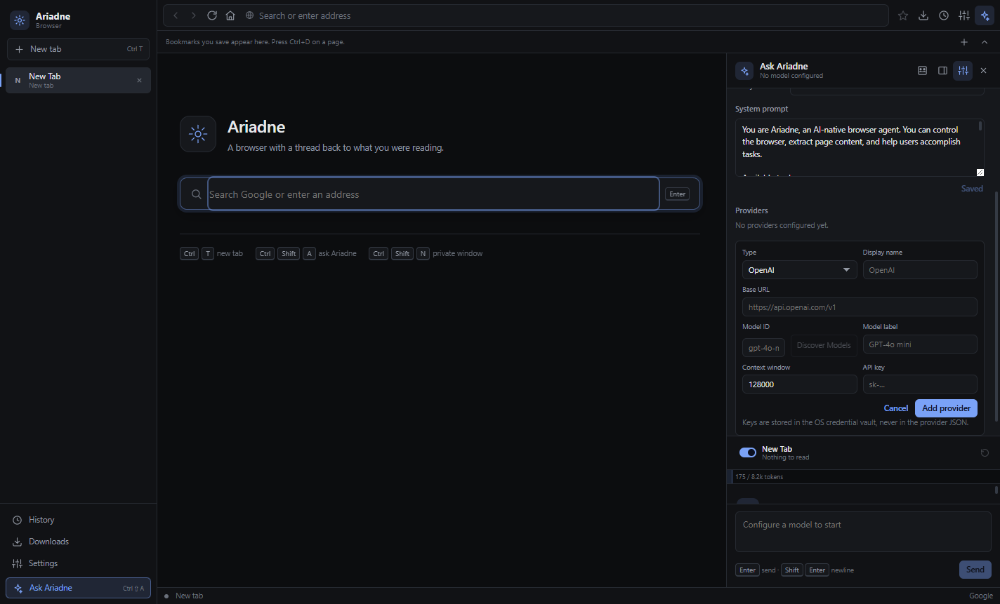

# Ariadne Browser

An AI-native desktop browser built with Electron, React, and TypeScript. **Browser first, AI second.**

---

## Honest Status (v0.2.0)

### What Actually Works

| Feature | Status | Notes |
|---------|--------|-------|
| Multi-tab browsing | ✅ Working | Horizontal tabs, drag-reorder, pin, mute, duplicate, middle-click close, reopen closed |
| Address bar + search | ✅ Working | URL entry, search detection, suggestions from history/bookmarks |
| Navigation | ✅ Working | Back, forward, reload, stop, home, view source (Ctrl+U) |
| Downloads panel | ✅ Working | Progress, pause/resume/cancel, open file/folder, retry, filter |
| Bookmarks bar + manager | ✅ Working | Nested folders, add/edit/delete/move, HTML import/export |
| History page | ✅ Working | Search, date groups, time filters, clear browsing data |
| Settings (7 sections) | ✅ Working | General, Appearance, Search, Privacy, **Security**, Shortcuts, AI, About |
| New Tab Page | ✅ Working | Search, top sites from history, recently closed |
| Find in page, zoom, fullscreen, print | ✅ Working | Ctrl+F, Ctrl+/-, Ctrl+0, F11, Ctrl+P |
| Private windows | ✅ Working | Separate `session.partition` (ephemeral, discarded on close) |
| Global shortcuts | ✅ Working | 30+ registered via app menu |
| Status bar | ✅ Working | Loading, zoom, security indicators |
| Persistent sessions | ✅ Working | SQLite history (1000 entries), survives restart |

### AI Features — What's Real vs Marketing

| Feature | Reality |
|---------|---------|
| **5 Providers** (OpenAI, Anthropic, 9Router, LM Studio, Custom) | ✅ Implemented, each with its own adapter |
| **Multi-API key per provider** | ✅ Keys stored in OS keychain (keytar), rotated on 429/401/403 |
| **Auto-fallback with context preservation** | ✅ Works: key rotation → retry with backoff → next provider, conversation context preserved |
| **Model slot routing (5 slots)** | ✅ UI assigns models to fastBrowsing/research/reasoning/coding/verification |
| **Streaming chat sidebar** | ✅ Works, stop button, citations for cross-tab context |
| **Cross-tab intelligence (BM25 retrieval)** | ✅ Extracts pages, chunks, indexes, answers with citations — 27 tests pass |
| **AI Agent (10 tools)** | ⚠️ **Tools exist and are callable**, but **approval UI is basic**, agent loops can get stuck, no persistent agent memory across sessions |
| **Page extraction** | ✅ Works via injected script, but **fails on SPA/heavy-JS sites** (React apps, infinite scroll, Shadow DOM) |
| **Model discovery** | ✅ "Discover Models" button calls `/v1/models`, "Add provider + key" auto-configures first model |

### Security — What's Real

| Feature | Reality |
|---------|---------|
| Safe Browsing (enhanced/standard/none) | ⚠️ **Placeholder** — local list only, no Google Safe Browsing API v4 integration |
| HTTPS-Only mode | ✅ Upgrades HTTP→HTTPS via `webRequest.onBeforeRequest` |
| Insecure site warnings | ✅ Warns on HTTP (optionally including private IPs) |
| DNS-over-HTTPS | ✅ Chromium switches (Google DNS), set at startup |
| Password breach check | ✅ HaveIBeenPwned k-anonymity (SHA-1 prefix only) |
| Ad/Tracker blocker | ⚠️ **declarativeNetRequest only works on `defaultSession`** — **does NOT work on custom partitions** (normal + private windows). Built-in 11 domains + EasyList download + per-site allowlist UI exist, but **blocking is inactive on your actual browsing partitions** |
| Security headers (CSP, X-Frame-Options, etc.) | ✅ Applied on all responses via `webRequest.onHeadersReceived` |
| Certificate manager | ✅ Opens `chrome://settings/certificates` |

### Performance

| Feature | Reality |
|---------|---------|
| Tab discarding at memory budget | ✅ 1.5GB default, discards inactive tabs, lazy restore |
| Memory stats in status bar | ✅ Shows RSS/heap, updates every 10s |

### Packaging

| Feature | Reality |
|---------|---------|
| Windows NSIS installer | ✅ Builds `Ariadne Browser Setup 0.2.0.exe` |
| GitHub Actions release | ✅ On tag push (`v*`), builds installer, creates release |

---

## Known Limitations (Be Harsh)

### Architecture — Single Webview
- **One `webview` per window**, tabs swapped via `src` attribute change
- **No true tab isolation** — crash in one tab kills all tabs in that window
- **No per-tab DevTools** — one DevTools for the webview
- **Session state tied to webview** — `webContents` is shared

### Private Windows ≠ Isolated Adblocking
- Private windows use `partition: ariadne-private-${uuid}`
- **declarativeNetRequest does not attach to custom partitions in Electron 45**
- Adblocker loads rules but **cannot apply them** to your actual browsing sessions
- This is an Electron limitation, not a bug in our code

### AI Agent — Prototype Grade
- Tools work individually (navigate, click, type, extract, screenshot, etc.)
- **No persistent agent state** — restart = fresh agent
- **Approval UI is a simple modal** — no "always allow for this domain", no bulk approval
- **Agent can loop infinitely** — no step budget, no cost tracking
- **No vision support** — tools are DOM/text only, cannot "see" the page
- **Cross-tab context not auto-injected** into agent — you must manually extract first

### Page Extraction — Brittle
- Injected script runs in page context, **fails on:**
  - Shadow DOM (closed mode)
  - Heavy React/Vue apps with virtualized lists
  - Sites with strict CSP blocking inline scripts
  - Infinite scroll (only captures current viewport)
- **No PDF/DOC extraction** — HTML only

### AI Provider Gaps
- **No streaming for Anthropic** — uses non-streaming endpoint, fakes chunks
- **9Router requires API key** — no keyless tier, discovery fails without key
- **Custom provider assumes OpenAI-compatible** — breaks on Ollama `/api/chat` vs `/v1/chat/completions` differences
- **No model capability detection** — context window, vision, tools must be entered manually or discovered

### Settings Persistence
- `electron-store` files in `%APPDATA%/ariadne-browser/`
- **No migration path** — schema changes = corrupted settings
- **AI config separate** (`ai-providers.json`) — not in electron-store

### Windows-Only Testing
- **Developed and tested on Windows 11 only**
- macOS/Linux: untested, likely broken (NSIS installer, keytar, paths, native modules)

### No Auto-Update
- No `electron-updater` integration
- Manual reinstall required for new versions

---

## Screenshots (Latest Security Build)

| New Tab Page | AI Sidebar | AI Settings | Add Provider Form |
|:------------:|:----------:|:-----------:|:-----------------:|
|  |  |  |  |

| Provider Form Filled | Provider Added | Settings (Security) | Appearance Settings | Web Page (detik.com) |
|:--------------------:|:--------------:|:--------:|:-------------------:|:---------------:|
|  |  |  |  |  |

---

## Demo


[Watch full demo video (MP4)](docs/demo.mp4)

### Indonesian Rhino Demo
Searches for "badak sumatera meninggal setelah dipindahkan indonesia" (Sumatran rhino conservation issue).


[Watch Indonesian Rhino demo video (MP4)](docs/demo-indonesian-rhino.mp4)

---

## Quick Start

```bash
# Install dependencies
npm install

# Build main + renderer
npm run build:electron
npm run build:renderer

# Run tests (27 context pipeline tests)
npm test

# Launch browser
npm start
```

### AI Setup

1. Open Settings → AI or click the 🤖 button in the address bar
2. Add a provider:
   - **LM Studio** (local, no API key): Start LM Studio server, add provider with base URL `http://localhost:1234/v1`
   - **OpenAI**: Add provider, set API key(s) via secure prompt
   - **Anthropic**: Add provider, set API key(s)
   - **9Router**: Add provider, set API key(s)
   - **Custom**: Any OpenAI-compatible endpoint (Ollama, vLLM, TGI, LocalAI, etc.)
3. Assign models to task slots (fastBrowsing, research, reasoning, coding, verification)
4. Use the AI sidebar (Ctrl+Shift+A) to chat with current page or cross-tab context

---

## AI Providers

| Provider | Type | Base URL | API Key Required | Notes |
|----------|------|----------|------------------|-------|
| OpenAI | `openai` | `https://api.openai.com/v1` | Yes | GPT-4o, GPT-4o-mini, etc. |
| Anthropic | `anthropic` | `https://api.anthropic.com/v1` | Yes | Claude 3.5 Sonnet, Haiku, Opus |
| 9Router | `9router` | `https://api.9router.com/v1` | Yes | Multi-model router |
| LM Studio | `lmstudio` | `http://localhost:1234/v1` | No | Local models via LM Studio server |
| Custom | `custom` | Any OpenAI-compatible | Optional | Ollama, vLLM, TGI, LocalAI, etc. |

**Multi-API Key Support:**
- Each provider stores **multiple API keys** in OS keychain
- **Automatic key rotation** on rate limits (429), auth errors (401/403)
- **Auto-fallback to next provider** with context preserved when all keys exhausted
- Configure in Settings → AI → Provider → "Add API Key"

---

## Project Structure

```
src/
├── main/                    # Electron main process
│   ├── index.ts             # App entry, IPC handlers, window management
│   ├── tabs.ts              # Tab state + SQLite history
│   ├── profile.ts           # Isolated profile support
│   ├── capture.ts           # Automated screenshot/demo capture
│   ├── security.ts          # Safe Browsing, HTTPS-Only, Adblock, Breach check
│   ├── ai/                  # AI system
│   │   ├── index.ts         # AISystem facade
│   │   ├── registry.ts      # ProviderRegistry: multi-key, auto-fallback, retry logic
│   │   ├── credentials.ts   # keytar secure storage
│   │   ├── provider.ts      # ProviderAdapter + BaseProvider (key rotation)
│   │   ├── types.ts         # Shared AI types
│   │   ├── agent-tools.ts   # 10 browser automation tools + approval UI
│   │   ├── providers/       # 5 provider implementations
│   │   └── context/         # Cross-tab intelligence (BM25, extraction, Q&A)
├── preload.ts               # contextBridge IPC surface
├── shared/                  # Shared utilities
└── renderer/                # React UI
    ├── main.tsx             # App shell, state, webview
    ├── styles.css           # Dark theme, all components styled
    └── components/          # TabStrip, AddressBar, SettingsPage, ChatSidebar, etc.
```

---

## Architecture

- **Single webview per window**, tabs swapped via `src` change (planned: WebContentsView per tab)
- **Partition `persist:ariadne`** for session persistence
- **Private windows** use unique partition `ariadne-private-${timestamp}`
- **AI runs in main process only** — renderer never sees API keys
- **Extraction script** injected via `executeJavaScript` into webContents
- **Settings** via `electron-store`
- **AI config** in `ai-providers.json` (providers, model slots, API key refs)

---

## Scripts

```json
{
  "build:electron": "tsc --project tsconfig.main.json && tsc --project tsconfig.preload.json && node scripts/copy-assets.js",
  "build:renderer": "vite build",
  "build": "npm run build:electron && npm run build:renderer",
  "start": "electron .",
  "test": "tsc --project tsconfig.tests.json && node --test dist-tests/tests/pipeline.test.js",
  "lint": "eslint src --ext .ts,.tsx"
}
```

---

## Target Environment

- Windows 11, 16 GB RAM, RX 6550M GPU
- Optimized for limited SSD (bounded caches, no idle polling)
- Minimal dependencies

---

## License

MIT

---

## If You're Evaluating This

**Use it if:** You want a local-first browser with integrated AI sidebar, cross-tab context retrieval, and you're okay with single-webview architecture and Windows-only.

**Don't use it if:** You need true tab isolation, working adblocker on all partitions, production-grade AI agent, or cross-platform support.

**Contributions welcome** — especially on: per-tab WebContentsView, declarativeNetRequest on custom partitions, agent vision/state, extraction robustness.